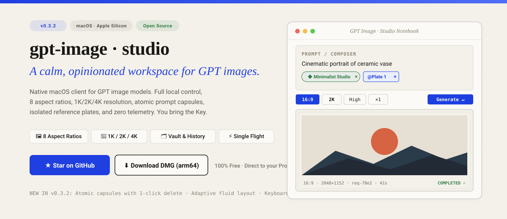
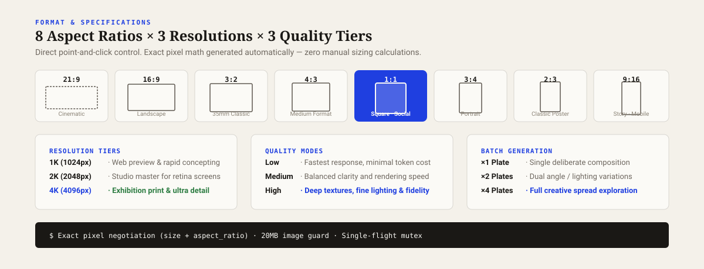
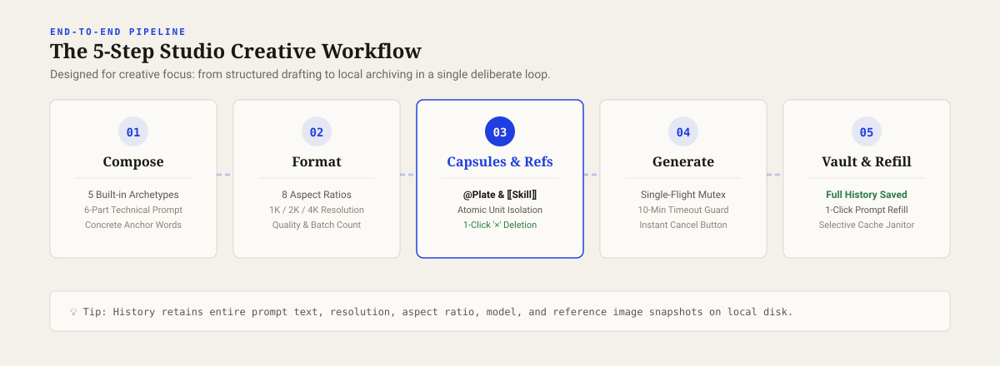
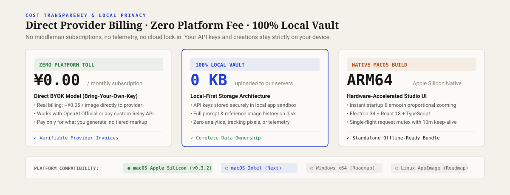
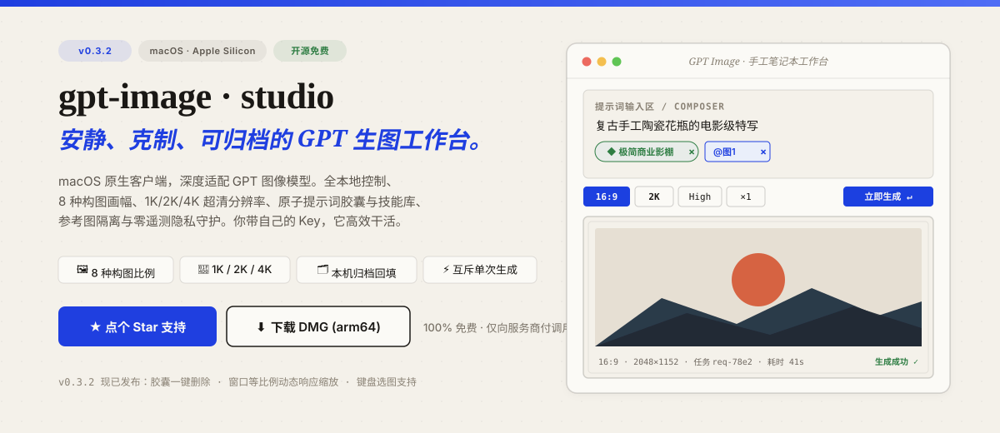
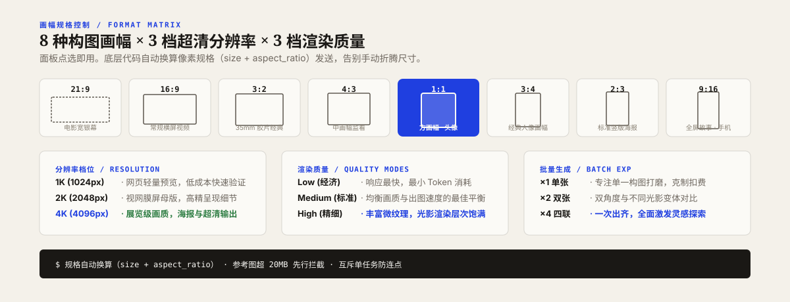
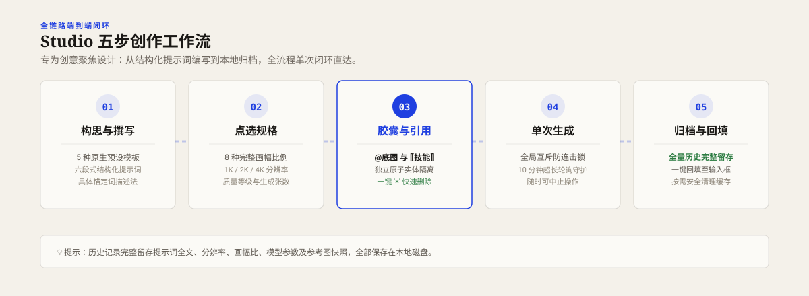
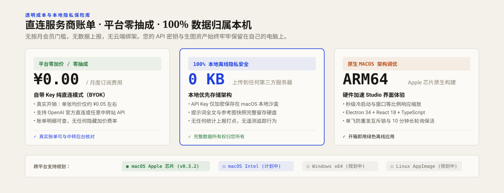

# gpt-image · studio

<p align="center">
  <a href="https://github.com/Zq1641/gpt-image-studio/releases/latest"></a>
  <a href="LICENSE"></a>
  <a href="https://github.com/Zq1641/gpt-image-studio/stargazers"></a>
  
  
</p>

<p align="center">
  <a href="#english">English Documentation</a> · <a href="#中文说明">中文说明文档</a> · <a href="#v032-highlights">v0.3.2 Highlights</a> · <a href="#download--install">Download .DMG</a>
</p>

---

<a id="english"></a>

## English

### What it is

**gpt-image · studio** is a tactile, privacy-first desktop studio for OpenAI's `gpt-image-2` / `gpt-image-2.5` image generation models (and OpenAI-compatible relay endpoints).

It replaces clunky web playgrounds, SDK terminal scripts, Base64 copying, and expensive subscription middleman fees with a calm, deliberate, studio-grade workstation engineered for creative flow.

<p align="center">
  
</p>

> **Hard to prompt? Overpriced subscriptions? Slow feedback loops?**  
> Studio is built to address creative friction: bring your own key (BYOK), atomic prompt capsules, instant proportional viewport scaling, and 100% local archiving.

---

### ✨ Highlights in v0.3.2

- 💊 **Atomic Prompt Capsules**: `@reference` images and `⟦Skill⟧` templates are parsed as isolated, atomic pills. Text you type afterwards remains separate, and capsules can be removed instantly with an inline `×` button or Backspace.
- 🖼 **8 Canonical Aspect Ratios**: Full creative matrix from `21:9` Ultra-wide cinematic banners to `9:16` vertical reels.
- 📐 **3 Resolution Tiers**: `1K` (Fast draft), `2K` (Default studio master), and `4K` (Ultra high-definition display).
- 🔒 **Single-Flight Concurrency Mutex**: Strict UI guard against double-clicking, preventing accidental double billing. Backed by a 10-minute long-polling keep-alive with instant cancel support.
- 🗂 **Local Privacy Vault & 1-Click Refill**: Full generation history with prompt text, resolution, model parameters, and reference snapshots saved safely to local disk. Refill any historic job with 1 click.
- ⚡️ **Proportional Window Auto-Adaptation**: The entire studio layout and typography scale smoothly with your window size without horizontal scroll jumps or cropped controls.

---

### 📐 Aspect Ratios & Resolution Matrix

Every format is rendered to native pixel coordinates with visual framing cards tailored for modern digital, social, and print pipelines:

<p align="center">
  
</p>

| Ratio | Pixel Dimensions (1K / 2K / 4K) | Primary Creative Scenarios |
| :--- | :--- | :--- |
| **`21:9`** | `1536 × 640` / `2560 × 1096` / `3840 × 1640` | Cinematic stills, ultra-wide hero banners, landing headers |
| **`16:9`** | `1344 × 768` / `2560 × 1440` / `3840 × 2160` | YouTube thumbnails, 4K desktop wallpapers, presentations |
| **`3:2`** | `1248 × 832` / `2400 × 1600` / `3600 × 2400` | 35mm classic photography, editorial spreads |
| **`4:3`** | `1152 × 864` / `2048 × 1536` / `3200 × 2400` | Medium format, retro portraits, tablet layouts |
| **`1:1`** | `1024 × 1024` / `2048 × 2048` / `4096 × 4096` | Square avatar, album art, Instagram feed posts |
| **`3:4`** | `864 × 1152` / `1536 × 2048` / `2400 × 3200` | Book covers, magazine covers, digital posters |
| **`2:3`** | `832 × 1248` / `1600 × 2400` / `2400 × 3600` | Fashion lookbooks, vertical portraits |
| **`9:16`** | `768 × 1344` / `1440 × 2560` / `2160 × 3840` | TikTok / Instagram Reels / YouTube Shorts, mobile wallpapers |

---

### 🔄 The 5-Step Creative Workflow

Studio breaks generation down into a structured, reliable 5-step pipeline:

<p align="center">
  
</p>

1. **Compose**: Draft structured prompts using 5 built-in style archetypes (E-Commerce, Photography, Poster, Creative, Fine Art) or concrete technical anchors.
2. **Format**: Select from 8 aspect ratios, 3 resolution tiers, and 3 quality levels.
3. **Capsules & Refs**: Drag and drop reference images, or type `@` to attach plates and `⟦Skill⟧` cards as atomic units.
4. **Generate**: Click generate under single-flight mutex protection with an active 10-minute timeout keep-alive.
5. **Vault & Refill**: Every generation is saved locally with full parameters. Click history items to refill inputs or manage cache.

---

### 💰 Direct BYOK Pricing & Privacy Vault

Studio believes you should own your tools, your data, and your relationship with AI providers:

<p align="center">
  
</p>

- **Zero Platform Markup**: You never pay a monthly subscription to Studio.
- **Direct Provider Billing**: Images are billed directly to your OpenAI account or preferred relay service (averaging ~¥0.05 / image on typical relays).
- **100% Local Storage**: Your API Key is stored only in your local macOS sandbox. No analytics, tracking pixels, or prompt harvesting.

---

<a id="download--install"></a>

### 📦 Installation

#### macOS (Apple Silicon: M1 / M2 / M3 / M4 / M5)

1. Download the latest packaged release: [**`GPT Image-0.3.2-arm64.dmg`**](https://github.com/Zq1641/gpt-image-studio/releases/download/v0.3.2/GPT%20Image-0.3.2-arm64.dmg) (≈ 94 MB).
2. Open the `.dmg` file and drag **GPT Image.app** into your **Applications** folder.
3. Open the app, click **Settings** (⚙️) in the top-right corner, enter your API Key and Base URL, and you are ready.

> **⚠️ Gatekeeper notice ("App is damaged" or unverified developer)?**  
> Because this is a free, self-funded open-source build without an annual $99 Apple Developer certificate, macOS Gatekeeper may show a warning on first launch.
> 
> Simply run this command in your Terminal to clear the quarantine flag:
> ```bash
> xattr -cr "/Applications/GPT Image.app"
> ```
> Or navigate to **System Settings → Privacy & Security**, scroll to the bottom, and click **"Open Anyway"**.

---

### 🛠 Building from Source

```bash
# 1. Clone this repository
git clone https://github.com/Zq1641/gpt-image-studio.git
cd gpt-image-studio

# 2. Install dependencies
npm install

# 3. Start development server with hot reload
npm start

# 4. Package standalone macOS DMG (Apple Silicon)
npm run dist:mac
```

Output files will be generated in the `release/` directory.

---

### 🗺 Roadmap

- [x] macOS Apple Silicon (M1–M5) Native App (v0.3.2)
- [x] Atomic prompt capsules with `@plate` references & inline deletion
- [x] Full history archiving, parameter refill & selective cache cleaner
- [x] Proportional responsive scaling
- [ ] macOS Intel (x64) release
- [ ] Windows 11 (x64 / ARM64) release
- [ ] Linux (AppImage) release
- [ ] Batch prompt generation queue

---

### 📄 License

[MIT](LICENSE) © 2026 pony

---

<br />

---

<a id="中文说明"></a>

## 中文说明文档

### 它是什么

**gpt-image · studio** 是一款为创意工作者打造的高品质 macOS 桌面生图工作台，专注于调用 OpenAI 的 `gpt-image-2` / `gpt-image-2.5` 原生图像生成模型及各大兼容中转服务商。

它将以往繁琐的官方网页控制台操作、代理网络调试、Base64 复制粘贴与下载归档流程，彻底整合为一个安静、克制、纯粹且具备专业排版美感的桌面创作空间。

<p align="center">
  
</p>

> **生图难？生图贵？生图慢？**  
> 这个工具正是为了解决这些痛点而生：自带 API Key（BYOK）、原子化提示词胶囊、全画幅比例点选、实时等比例自适应缩放以及 100% 本地隐私归档。

---

<a id="v032-highlights"></a>

### ✨ v0.3.2 重点特性

- 💊 **原子化提示词胶囊（全新升级）**：在输入框中输入 `@` 引入参考图或点击预设生成的 `⟦技能⟧`，均被渲染为独立原子实体。后续键入的文字绝不与胶囊粘连，胶囊自带 `×` 极速移除按钮，按 Backspace 键直接整块删除。
- 🖼 **8 种专业全场景画幅**：从 `21:9` 电影级超宽屏横幅到 `9:16` 竖屏短视频封面全覆盖。
- 📐 **三档超清分辨率**：支持 `1K`（极速构想）、`2K`（标准工作室）、`4K`（顶级超清细节）。
- 🔒 **单飞防重发互斥锁**：生成按钮带有全局排他锁，彻底杜绝多次点击造成的重复调用与扣费；支持长达 10 分钟的静默长轮询守护与随时一键紧急中止。
- 🗂 **100% 本地隐私保险库**：历史生成记录完整留存提示词全文、分辨率、模型参数与参考底图快照；支持一键回填至输入框继续迭代，支持精细化安全清理磁盘缓存。
- ⚡️ **全界面等比例自适应缩放**：无论窗口如何拉伸或缩放，界面所有模块、按钮与字体均自动等比例自适应缩放，无冗余滚动条跳动。

---

### 📐 画幅规格与分辨率矩阵

所有尺寸均对齐标准像素规格，涵盖数字媒体、社交传播与高清打印需求：

<p align="center">
  
</p>

| 比例 | 像素规格 (1K / 2K / 4K) | 推荐使用场景 |
| :--- | :--- | :--- |
| **`21:9`** | `1536 × 640` / `2560 × 1096` / `3840 × 1640` | 电影宽银幕、官网超宽 Banner、落地页主视觉 |
| **`16:9`** | `1344 × 768` / `2560 × 1440` / `3840 × 2160` | YouTube 封面、4K 电脑桌面壁纸、PPT 演示文稿 |
| **`3:2`** | `1248 × 832` / `2400 × 1600` / `3600 × 2400` | 35mm 经典单反画幅、画册刊物排版 |
| **`4:3`** | `1152 × 864` / `2048 × 1536` / `3200 × 2400` | 中画幅摄影、复古胶片人像、平板电脑壁纸 |
| **`1:1`** | `1024 × 1024` / `2048 × 2048` / `4096 × 4096` | 正方形社交头像、黑胶唱片封面、Instagram 帖子 |
| **`3:4`** | `864 × 1152` / `1536 × 2048` / `2400 × 3200` | 图书封面、杂志内页、竖版展览海报 |
| **`2:3`** | `832 × 1248` / `1600 × 2400` / `2400 × 3600` | 时尚大片、全尺寸竖向人物写真 |
| **`9:16`** | `768 × 1344` / `1440 × 2560` / `2160 × 3840` | 抖音 / 小红书 / 微信视频号 / 手机全屏壁纸 |

---

### 🔄 Studio 五步标准创作工作流

工具严格按照专业创作者心流，打磨出顺畅的端到端闭环体验：

<p align="center">
  
</p>

1. **构思与撰写**：利用 5 种内置风格模板（电商 / 摄影 / 海报 / 创意 / 艺术）或六段式结构化提示词快速搭建构图。
2. **点选规格**：直观选择 8 种画幅比、3 档分辨率与质量等级。
3. **胶囊与引用**：拖入参考底图，在提示词中输入 `@` 唤出底图胶囊，或点击技能库插入独立技能胶囊。
4. **单次生成**：点击生成，单飞互斥锁启动，10 分钟长轮询保活守护，支持随时取消。
5. **归档与回填**：生图成功后自动归档到本地；点击历史卡片可一键回填参数与参考图快照，亦可精细化清理本地缓存。

---

### 💰 成本透明与本地隐私保险库

我们始终坚持工具的纯粹性与数据主权：

<p align="center">
  
</p>

- **平台零抽成 / 零按月会员门槛**：软件永久免费开源，绝无任何中间商加价。
- **自带 Key 纯直连**：每一张图均直接计入您的 OpenAI 官方或中转站账户（中转服务商单张成本通常仅约 ¥0.05 左右，实测可与账单严格核对）。
- **100% 本地隐私归属**：API Key 仅加密保存在 macOS 沙盒中，提示词与图像资产全在本地，绝无任何第三方数据采集或遥测追踪。

---

### 📦 安装与使用

#### macOS (Apple 芯片: M1 / M2 / M3 / M4 / M5)

1. 前往 Releases 页面下载最新安装包：[**`GPT Image-0.3.2-arm64.dmg`**](https://github.com/Zq1641/gpt-image-studio/releases/download/v0.3.2/GPT%20Image-0.3.2-arm64.dmg)（约 94 MB）。
2. 双击打开 `.dmg`，将 **GPT Image.app** 拖入系统的 **Applications（应用程序）** 文件夹。
3. 打开应用，点击右上角 **Settings（设置）** 齿轮图标，填入您的 API Key 和 Base URL 即可开始畅快生图。

> **⚠️ 安装后提示"已损坏"或无法验证开发者？**  
> 由于开源作者未加入每年 $99 的 Apple 开发者计划，未经过 Apple 官方公证签名。macOS Gatekeeper 安全机制会在首次运行时进行拦截，这是开源软件的正常现象。
> 
> **解决方法（只需执行一次）：**  
> 打开终端（Terminal），粘贴并执行以下命令解除隔离属性：
> ```bash
> xattr -cr "/Applications/GPT Image.app"
> ```
> 或者前往 **系统设置 → 隐私与安全性**，滑动到底部，点击 **"仍要打开"** 即可正常运行。

---

### 🛠 本地源码构建与运行

```bash
# 1. 克隆代码仓库
git clone https://github.com/Zq1641/gpt-image-studio.git
cd gpt-image-studio

# 2. 安装所有依赖包
npm install

# 3. 启动开发模式（支持热重载）
npm start

# 4. 打包生成独立的 macOS DMG 安装包（Apple Silicon）
npm run dist:mac
```

打包完成后，安装文件将输出在 `release/` 目录下。

---

### 🗺 产品规划路线图

- [x] macOS Apple Silicon 原生支持（v0.3.2）
- [x] 原子化提示词胶囊与 `@底图` 快速插入/删除
- [x] 完整参数本地历史留存、一键回填与安全缓存清理
- [x] 窗口等比例自适应缩放体验
- [ ] macOS Intel (x64) 架构适配
- [ ] Windows 11 (x64 / ARM64) 版本
- [ ] Linux (AppImage) 版本
- [ ] 批量排队生图任务系统

---

### 📄 开源协议

本项目采用 [MIT](LICENSE) 开源协议。
